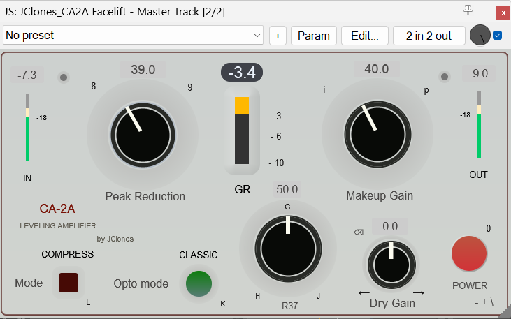
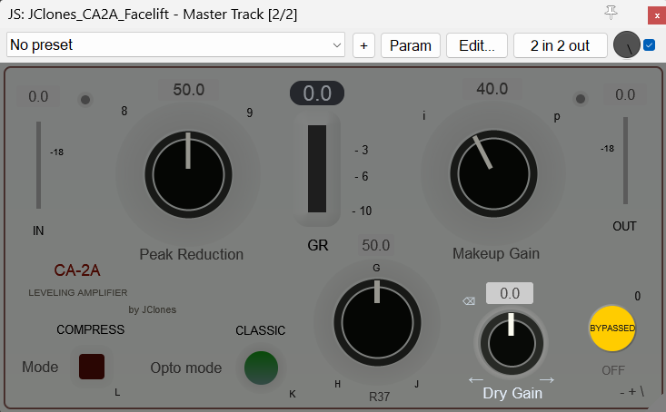
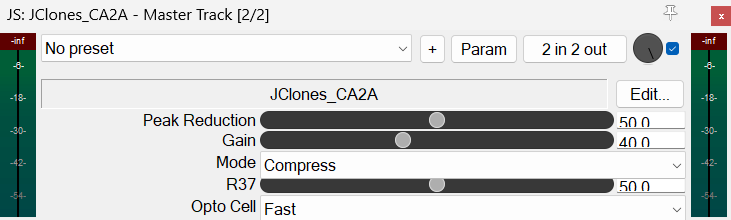

# JClones CA2A Facelift

**JClones CA2A with a new GUI made in [Facelift](https://github.com/heavywateraudio/facelift-jsfx).**

CA2A is a smooth, musical leveling compressor, a clone of the classic LA-2A tube optical compressor.
The original JClones CA2A has no GUI, only REAPER's stock sliders.
This version gives it a face, built in Facelift, with meters, extra controls and keyboard keys.
The sound is the original [JClones CA2A](JClones_CA2A.md) DSP by JClones.

*JClones CA2A with its Facelift face in REAPER.*

*Bypassed: the face dims and the POWER button turns yellow.*

## What the new GUI adds

- A gray rack face with black knobs and a red name label.
- Peak Reduction, Makeup Gain and R37 knobs, each with a label and a number box.
- Mode button (COMPRESS / LIMIT) and Opto Cell button (CLASSIC / FAST), each with a label.
- The Opto Cell button is green on CLASSIC and red on FAST.
- IN and OUT meters with labels, number boxes and a -18 mark.
- IN and OUT LEDs that light red at 0 dB or above.
- GR meter with a label, a number box and marks at -3, -6 and -10. Its bar is amber and turns white at -9.5.
- Dry Gain knob with a label and a number box.
- POWER button with a label.
- Keyboard keys for every control. Each control shows its key beside it.
- `-` `+` `\` keys to scale the whole window.

## Keyboard keys

| Key           | What it does                 |
| ------------- | ---------------------------- |
| `8` `9`       | Peak Reduction               |
| `I` `P`       | Makeup Gain                  |
| `H` `J`       | R37                          |
| `G`           | Resets R37                   |
| `L`           | Mode: Compress or Limit      |
| `K`           | Opto Cell: Classic or Fast   |
| `←` `→`       | Dry Gain                     |
| `Backspace`   | Resets Dry Gain              |
| `0`           | POWER                        |
| `-` `+` `\`   | Scale the plugin window      |

## Download

**[Download JClones_CA2A_Facelift.jsfx](https://github.com/heavywateraudio/JClones-Facelift/releases/download/ca2a-facelift-v1.0.2/JClones_CA2A_Facelift.jsfx)**

It's one file with everything inside.
[View the code](https://github.com/heavywateraudio/JClones-Facelift/blob/master/jsfx/JClones_CA2A_Facelift.jsfx) on GitHub.

## Install

1. In REAPER, open **Options > Show REAPER resource path**.
2. Open the `Effects` folder.
3. Copy `JClones_CA2A_Facelift.jsfx` into it.
4. In REAPER, open the FX window, click **Options**, then **Rescan all plug-ins**.
5. Search for `JClones_CA2A_Facelift` and add it to a track.

## Changes to the original code

These are added:

- Dry Gain: mixes the dry signal back in.
- Bypass: the POWER button turns the effect on and off.
- IN, OUT and GR meters, each with a number box.
- IN and OUT LEDs that light red at 0 dB or above.

One default is changed:

- Opto Cell starts on Classic (was Fast).

The stock sliders are hidden, because the new face shows every control.
Everything else is the original, including the control names and steps.
See [JClones CA2A](JClones_CA2A.md) for what each control does.

## Original look

*Original JClones_CA2A jsfx face.*

## Credits

- DSP: [JClones](https://github.com/JClones/JSFXClones), v1.1.0, MIT License.
- GUI: Andy Rx (heavywateraudio), v1.0.2, MIT License.
- See [LICENSE](LICENSE) and [NOTICE](NOTICE).
