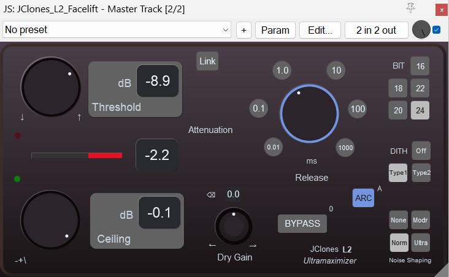
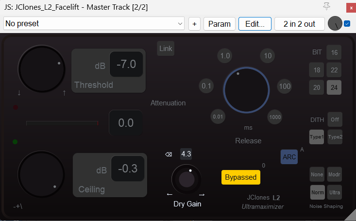
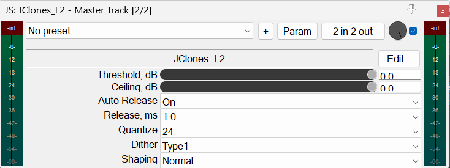

# JClones L2 Facelift

**JClones L2 with a new GUI made in [Facelift](https://github.com/heavywateraudio/facelift-jsfx).**

L2 is a brickwall limiter for mastering and level control.
The original JClones L2 has no GUI, only REAPER's stock sliders.
This version gives it a face, built in Facelift, with a gain reduction meter, extra controls and keyboard keys.
The sound is the original [JClones L2](JClones_L2.md) DSP by JClones.

*JClones L2 with its Facelift face in REAPER.* 

 

*Bypassed: the face dims and the button turns yellow.* 

 

## What the new GUI adds

- Link button: moves Threshold and Ceiling together.
- Attenuation meter with a number box. It shows how much the limiter is turning the level down.
- Two lights to the left of the Attenuation meter show the audio coming into L2, before any limiting:
  - Green (bottom): audio is coming in, and its peaks are below 0 dB.
  - Red (top): the incoming peaks reach 0 dB or more. This is normal when you feed a limiter hot. It does not mean L2's output is clipping.
- Dry Gain knob with a label and a number box.
- BYPASS button that fades smoothly, with no click.
- Keyboard keys for Threshold, Auto Release, Dry Gain and BYPASS.
- `-` `+` `\` keys to scale the whole window.

The original controls are all still here, with a new look:

- Threshold, Ceiling and Release are knobs.
- Auto Release is the ARC button. While it is on, the Release knob is locked.
- Quantize, Dither and Shaping are buttons, labeled BIT, DITH and Noise Shaping.

## Keyboard keys

| Key           | What it does              |
| ------------- | ------------------------- |
| `↑` `↓`       | Threshold                 |
| `A`           | ARC (Auto Release)        |
| `←` `→`       | Dry Gain                  |
| `Backspace`   | Resets Dry Gain           |
| `0`           | BYPASS                    |
| `-` `+` `\`   | Scale the plugin window   |

## Download

**[Download JClones_L2_Facelift.jsfx](https://github.com/heavywateraudio/JClones-Facelift/releases/download/l2-facelift-v1.0.2/JClones_L2_Facelift.jsfx)**

It's one file with everything inside.
[View the code](https://github.com/heavywateraudio/JClones-Facelift/blob/master/jsfx/JClones_L2_Facelift.jsfx) on GitHub.

## Install

1. In REAPER, open **Options > Show REAPER resource path**.
2. Open the `Effects` folder.
3. Copy `JClones_L2_Facelift.jsfx` into it.
4. In REAPER, open the FX window, click **Options**, then **Rescan all plug-ins**.
5. Search for `JClones_L2_Facelift` and add it to a track.

## Changes to the original code

These are added:

- Link: moves Threshold and Ceiling together.
- Dry Gain: sets the level of the dry signal when bypassed.
- Bypass: the BYPASS button turns the effect on and off.
- Attenuation meter with a number box.
- Two lights for the incoming level: green below 0 dB, red at 0 dB or more.

The stock sliders are hidden, because the new face shows every control.
Everything else is the original, including the control names, steps and defaults.
See [JClones L2](JClones_L2.md) for what each control does.

## Original look

*Original JClones_L2 jsfx face.* 

 

## Credits

- DSP: [JClones](https://github.com/JClones/JSFXClones), v1.1.0, MIT License.
- GUI: Andy Rx (heavywateraudio), v1.0.2, MIT License.
- See [LICENSE](LICENSE) and [NOTICE](NOTICE).
