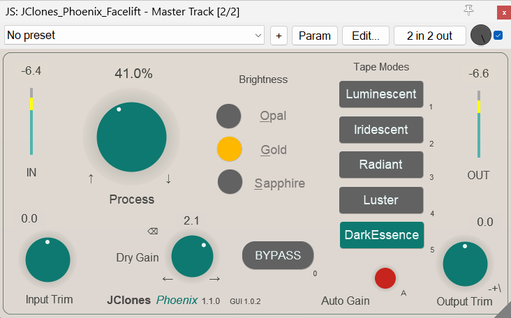

# JClones Phoenix Facelift

**JClones Phoenix with a new GUI made in [Facelift](https://github.com/heavywateraudio/facelift-jsfx).**

Phoenix gives your tracks an analog tape sound: warmth, depth and soft harmonic distortion.
JClones recently gave Phoenix its own GUI.
This version is a second face, built in Facelift, with extra controls and keyboard keys.
The sound is the original [JClones Phoenix](JClones_Phoenix.md) DSP by JClones.

*JClones Phoenix with its Facelift face in REAPER.*

## What the new GUI adds

- Bypass button with a label.
- Dry Gain knob with a label and a number box.
- IN and OUT meters with labels and number boxes.
- Keyboard keys for every control. Each control shows its key beside it.
- `-` `+` `\` keys to scale the whole window.

## Keyboard keys

| Key                       | What it does                  |
| ------------------------- | ----------------------------- |
| `↑` `↓`                   | Process                       |
| `←` `→`                   | Dry Gain                      |
| `Backspace`               | Resets Dry Gain               |
| `0`                       | Bypass                        |
| `1` to `5`                | Tape Modes                    |
| `A`                       | Auto Gain                     |
| `O` `G` `S` (underlined)  | Opal, Gold, Sapphire          |
| `-` `+` `\`               | Scale the plugin window       |

## Download

**[Download JClones_Phoenix_Facelift.jsfx](https://github.com/heavywateraudio/JClones-Facelift/releases/download/phoenix-facelift-v1.0.1/JClones_Phoenix_Facelift.jsfx)**

It's one file with everything inside.
[View the code](https://github.com/heavywateraudio/JClones-Facelift/blob/master/jsfx/JClones_Phoenix_Facelift.jsfx) on GitHub.

## Install

1. In REAPER, open **Options > Show REAPER resource path**.
2. Open the `Effects` folder.
3. Copy `JClones_Phoenix_Facelift.jsfx` into it.
4. In REAPER, open the FX window, click **Options**, then **Rescan all plug-ins**.
5. Search for `JClones_Phoenix_Facelift` and add it to a track.

## Changes to the original code

Three controls move in bigger steps, so knobs and keys feel right:

- Input Trim moves in steps of 0.1 (was 0.01).
- Process moves in steps of 1 (was 0.01).
- Output Trim moves in steps of 0.1 (was 0.01).

Everything else is the original, including the control names.
See [JClones Phoenix](JClones_Phoenix.md) for what each control does.

## Credits

- DSP: [JClones](https://github.com/JClones/JSFXClones), v1.1.0, MIT License.
- GUI: Andy Rx (heavywateraudio), v1.0.1, MIT License.
- See [LICENSE](LICENSE) and [NOTICE](NOTICE).
